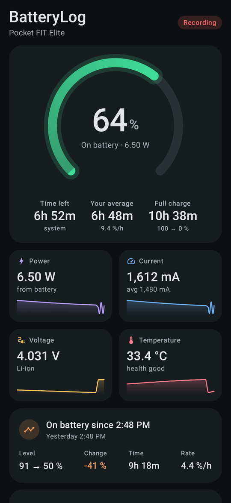
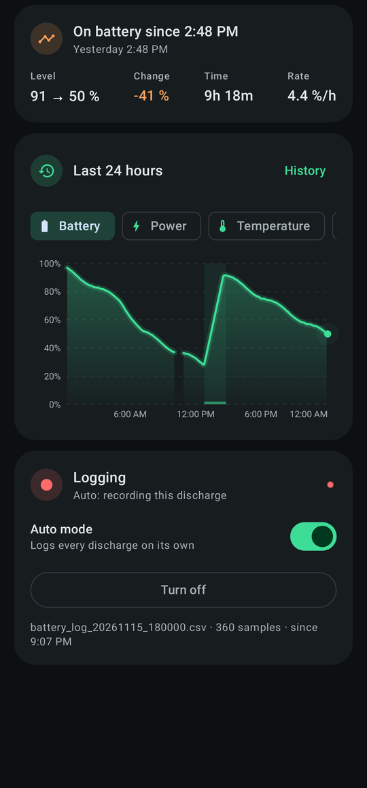
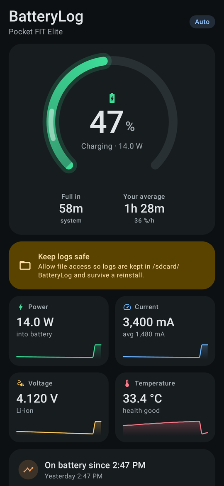
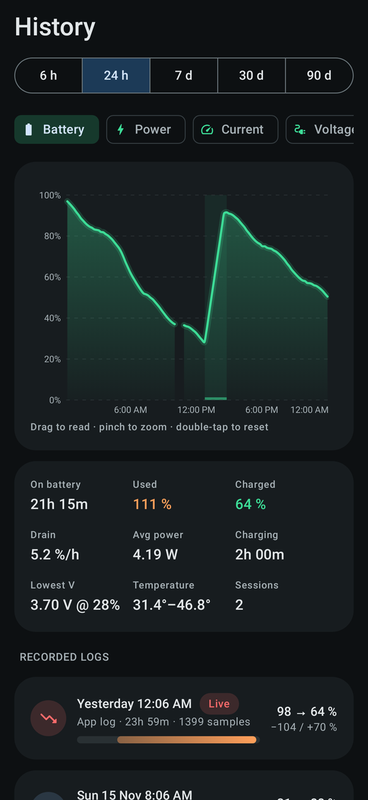
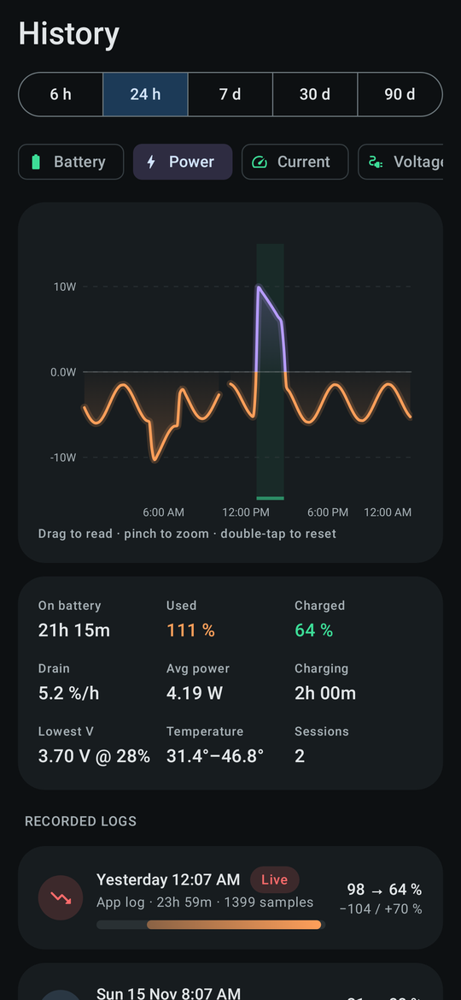
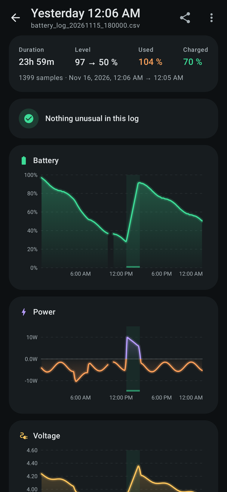
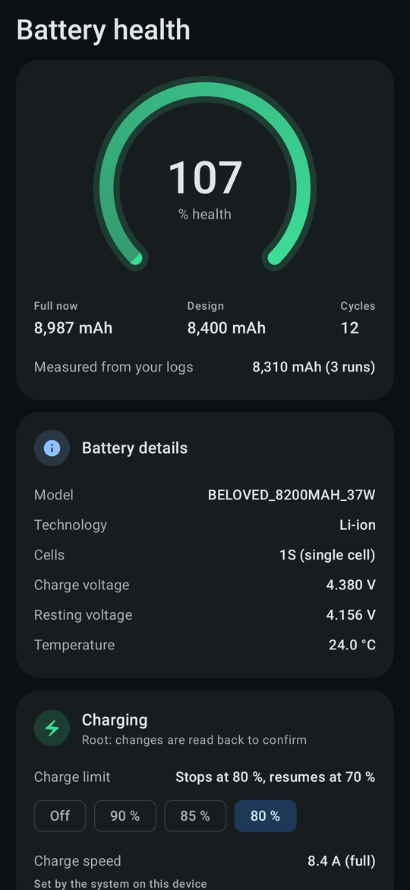
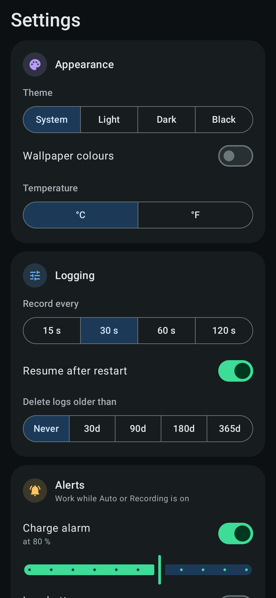
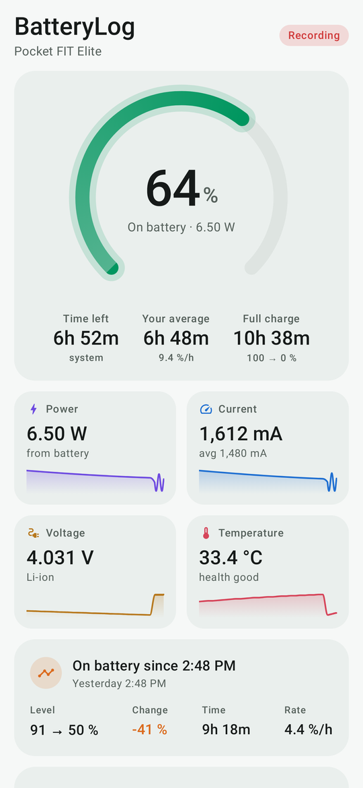

# BatteryLog

An Android app that logs your battery in the background and shows it in clear, interactive charts:
level, power, current, voltage and temperature, battery health, time left, and a report for every log.
It started as a tool to chase random shut-offs on the AYANEO Pocket FIT and works on any Android 10+ device.

- **Package:** `com.the412banner.batterylog.debug` (kept from the first releases so updates install over them)
- **UI:** Kotlin, Jetpack Compose, Material 3 (light, dark, black, optional wallpaper colours)
- **Android:** 10 (API 29) or newer, target API 36
- **Root:** not needed for logging, charts and reports. Needed for the boot logger, charge control and per-app monitoring.

## Screens

<table>
  <tr>
    <td></td>
    <td></td>
    <td></td>
  </tr>
  <tr>
    <td></td>
    <td></td>
    <td></td>
  </tr>
  <tr>
    <td></td>
    <td></td>
    <td></td>
  </tr>
</table>

<sub>Screenshots are rendered from the app's own screens with sample data (see `ScreenshotTest`).</sub>


**Now**: an animated battery ring and the current state (charging, watts). Time left from the system
estimate and from your own average. Live tiles for power, current, voltage and temperature, each with a
30-minute trend line. A "since last charge" summary, the last 24 hours as a chart, and the logging controls.

**History**: one large chart for 6 h, 24 h, 7 days, 30 days or 90 days, switchable between level, power,
current, voltage and temperature. Charging periods are shaded. Below it: time on battery, % used and
charged, drain rate, average power, lowest voltage, temperature range, and the list of every log.

**Log details**: synced charts for one log. Dragging on one chart shows the same moment on all of them,
and zooming one zooms all. Below the charts: a report covering capacity used, measured full capacity,
health against the design capacity, voltage (including per cell and a voltage-per-10 % curve),
average/peak draw and charging power, speed, temperature, and findings (possible shut-off, voltage sag,
hot battery, low capacity). You can share the report, share the CSV or delete the log.

**Health**: health ring (full capacity vs design), charge cycles, capacity measured from your own logs,
and battery details (model, technology, cells, charge and resting voltage). Also charge limit and charge
speed (root), the boot logger, and log storage (share all logs as a zip, delete old logs).

**Settings**: theme, °C/°F, record interval (15/30/60/120 s), resume after restart, auto-delete old logs,
alerts, updates.

### Charts
Smooth curves with a gradient fill. When zoomed out, a light band shows the min/max inside each point.
Charts animate in when the range or metric changes.
- **Drag** sideways to read the exact value and time
- **Tap** to read a point
- **Pinch** to zoom, two-finger drag to pan
- **Double-tap** to reset

Gaps when nothing was logged are left empty, not bridged with a straight line.

## Logging

- **Auto mode** (recommended): stays running and starts a new log every time you unplug the charger,
  then closes it when you plug back in.
- **Record now**: logs right away until you stop it (or the battery reaches 0 %).
- A sample is written every 30 s by default and synced to disk each time, so the end of a log survives
  a hard shut-off.
- After a reboot (if "Resume after restart" is on) or an app update, the last mode starts again.
- The logger runs as a `specialUse` foreground service, not `dataSync`, so Android 14+ doesn't stop it
  after 6 hours.

**Alerts** (while Auto or Recording is on): a charge alarm at a chosen %, a low-battery alert, and a
hot-battery alert.

**Quick settings tile**: shows the level and live watts; tap to open the app.

### Boot logger (root, optional)
**Health → Boot logger → Install** adds a small Magisk module, `batterylog_boot`. It starts a shell
logger at every boot that writes the same CSV columns, so logs cover the minutes before a shut-off even
if the app never opened. Where the app is also logging, the app's rows are used and the boot logger's
rows for the same time are skipped.

## Per-app monitoring (root, optional)

**Settings → Per-app monitoring** records, every 2–30 s, the app on screen, the device's power, CPU and GPU load,
GPU clock and temperatures (CPU, GPU, skin, memory, battery), plus each app's CPU time, RAM and GPU memory.

- **Apps** tab: apps ranked by battery used, screen time, CPU, RAM or GPU memory for Today / 24 h / 7 days.
- Tap an app: one big chart with chips for Power, App CPU, GPU, CPU temp, GPU temp, RAM, GPU memory and CPU
  (always), charging shaded, plus a summary.
- **Show all metrics**: min / avg / max of every metric and the raw readings.

Watts per app = the whole device's power while that app is on screen (Android does not measure one app on its
own); GPU load is device-wide and credited to the app on screen. CPU time, RAM and GPU memory are per app.
Files: `/sdcard/BatteryLog/apps/timeline-<day>.csv` and `apps-<day>.csv`.

## Storage

Logs are saved in `/sdcard/BatteryLog/logs` once **All files access** is allowed, so they survive an
uninstall. Without it they go to the app's own folder.

One header line, then one row per sample:
```
epoch_ms,iso_time,uptime_ms,capacity_pct,status,plugged,
voltage_mV,current_uA,charge_counter_uAh,energy_counter_nWh,temp_decideg,health
```
`plugged` is `ac` / `usb` / `wireless` / `unplugged` for app rows and `boot` for boot-logger rows.

## Charge control (root)

- **Charge limit**: stops charging at 90 / 85 / 80 % (100 = off), using
  `charge_control_start/end_threshold`.
- **Charge speed** (`charge_control_limit`): shown as a level (0 = full speed) or, on devices where the
  node is a current, in amps. The app never sets a current node below 10 % of its maximum. Nodes the
  kernel marks read-only (for example on the Pocket FIT Elite) are shown but can't be changed.

Every change is read back to confirm it stuck. Whether the charger firmware enforces it depends on the
device.

## Updates

The app checks this repository's GitHub releases every 12 hours (it can be turned off), and you can also
check from **Settings → Updates**. It downloads the APK, checks its SHA-256 against the release's
`.sha256` file, makes sure it is BatteryLog, and hands it to Android's installer. Test builds are offered
only if "Include test builds" is on.

Coming from 1.6.0 or older: install 2.0 once by hand. 1.6.0 has no updater, but 2.0 installs over it and
keeps your logs. Every release is signed with the same AOSP test key (v1 + v2 + v3).

## Install

Download `BatteryLog-v<version>-<commit>.apk` from [Releases](https://github.com/The412Banner/BatteryLog/releases)
and open it. On Samsung, if Android blocks the install, turn off **Auto Blocker** in Settings →
Security and privacy.

## Build

GitHub Actions builds on every push (`./gradlew :app:assembleRelease`, JDK 17), signs with the AOSP test key
using `apksigner` (v1 + v2 + v3), runs the unit tests, and renders every screen with sample data into the
`screenshots` artifact (Robolectric + Roborazzi). No local Android SDK needed.

## License

BatteryLog is licensed under the GNU General Public License v3.0 (see [LICENSE](LICENSE)).
